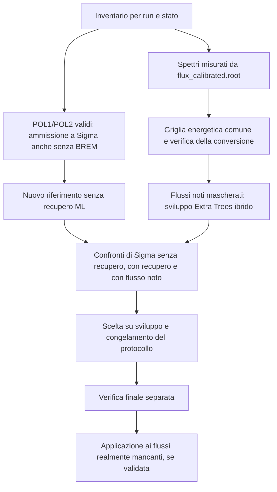

# Recupero dei flussi calibrati e analisi di Σ

Data: 10 novembre 2026. Stato: revisione tecnica preliminare completata, in attesa dell'approvazione del responsabile scientifico. Questo documento consolida la discussione del 10 novembre; non avvia implementazioni, estrazioni o campagne. L'implementazione e il protocollo numerico di validazione saranno passi successivi.

## 1. Obiettivo e decisioni concordate

Recuperare eventi utilizzabili per l'asimmetria di fascio Σ, valutando separatamente il recupero ottenibile con i flussi polarizzati già misurati e quello aggiuntivo ottenibile con flussi stimati.

Decisioni espresse dal responsabile scientifico:

1. **Primo passo:** ammettere allo studio di Σ le run con POL1/POL2 validi anche quando BREM manca, preservando gli altri requisiti di qualità e di esposizione. Quantificare questo recupero prima di attribuire benefici al ML.
2. Usare gli spettri POL1, POL2 e BREM presenti in `data/00_external/flux_calibrated.root` come sorgente misurata per lo studio.
3. Ricostruire gli spettri mancanti **su una griglia energetica comune**, anziché apprendere direttamente i contenuti per strip.
4. Mantenere **Extra Trees ibrido come unico modello ML**. L'interpolazione resta la componente che determina l'integrale e un riferimento diagnostico; Kernel Ridge, Ridge, MLP e CNN non entrano nel nuovo confronto.
5. Giudicare il recupero attraverso le asimmetrie con/senza flussi recuperati. Parametri e criteri si sviluppano su flussi noti mascherati, con successiva verifica separata.

Le scelte tecniche indicate come proposte in questo documento non sono risultati sperimentali né decisioni numeriche già approvate.

## 2. Stato attuale verificato

Gli stimatori ratio e likelihood usano POL1/POL2; gli eventi BREM alimentano controlli indipendenti. Il caricatore `flux_v2.py` richiede invece tutti e tre gli istogrammi e rifiuta la run incompleta. Anche il dataset corrente dei vicini ammette soltanto triplette complete: tale vincolo va separato dalla disponibilità del singolo stato per lo studio.

Il file calibrato conserva contenuti per strip con assi energetici propri della run/stato. Il dataset supporta già un rebinning conservativo in energia; la griglia storica è composta da 128 bin uniformi fra 0,5 e 2,0 GeV. Il raccordo degli spettri energetici all'estrattore attuale richiede ancora esposizioni per `(run, strip)`.

Lo studio precedente osservò un effetto della conversione di griglia sul ratio fino a circa 0,35 errori statistici in un confronto locale. Il successivo percorso nativo eliminò quell'effetto di rappresentazione. La nuova strada energetica deve quindi superare una verifica dedicata prima di interpretare i risultati del ML.

Ultimo esito scientifico storico, 21 ottobre 2026: `selected_policy=null`, nessuna adozione in produzione. I conteggi storici di run/eventi recuperabili non valgono automaticamente per il nuovo disegno. I report sono recuperabili nella cronologia Git; la disponibilità dei loro prodotti dettagliati va verificata, non presunta.

## 3. Flusso dello studio



Il recupero della prima fase e quello ML devono avere conteggi distinti. La baseline dei confronti ML include le run ammesse nella prima fase.

## 4. Input, popolazione e assenze

### 4.1 Input dichiarati

| Input | Uso e requisito |
| --- | --- |
| `config/support/run_manifest.csv` | Identità, ordine e gruppi sperimentali delle run protoniche |
| `config/support/run_quality_exclusions.json` | Esclusioni condivise, applicate a tutti gli stati e a tutti i ruoli |
| `data/00_external/flux_calibrated.root` | Spettri misurati, assi energetici e identità degli istogrammi |
| h80 inclusivi della campagna dichiarata | Conteggi per run/stato e, dove necessario, calibrazione indipendente strip→energia |
| Ricostruiti UV/VIS dichiarati | Eventi selezionati e provenienza per i confronti di Σ |
| Configurazione dell'estrazione | Polarizzazione, tagli, bin energetici/di massa/φ, candle e convenzioni in uso |

La popolazione iniziale è l'insieme delle run P del manifest; l'inventario distingue quelle prive degli input necessari. Le valutazioni quantitative riguardano soltanto il cohort esplicitamente identificato dagli input realmente disponibili. Non si presume che il cohort completo sia presente sul disco locale.

Per ogni input conservare hash, identità ROOT, alberi/istogrammi consumati e compatibilità del cohort. I conteggi inclusivi non provengono dalla sola selezione ηπ⁰. Le cache si riusano soltanto per gli input autenticati cui si riferiscono.

### 4.2 Inventario per stato

Distinguere istogramma assente, duplicato, contenuto non finito/negativo, asse non valido, conteggio inclusivo assente, calibrazione indipendente insufficiente e run esclusa per qualità. Non equiparare assenza nel calibrato ad assenza del grezzo. Un contenuto realmente nullo non è automaticamente un istogramma mancante.

Le anomalie della policy condivisa restano escluse da dati, donatori, training e recupero. Il modello non corregge né riabilita tali run. Gli istogrammi presenti ma difettosi restano una categoria distinta: non sono sovrascritti con stime senza una decisione scientifica specifica.

## 5. Prima fase: Σ con POL1/POL2 validi senza BREM

L'ammissione a Σ richiede entrambi i flussi polarizzati e i corrispondenti requisiti di energia, polarizzazione, esposizione, qualità e provenienza. L'assenza di BREM non è di per sé motivo di esclusione da Σ.

BREM mantiene uno stato di disponibilità esplicito. Un'assenza non diventa flusso zero, controllo vuoto certificato o controllo superato. I controlli BREM usano soltanto le run/esposizioni con BREM misurato valido e dichiarano il proprio denominatore; eventuali BREM stimati saranno un campione distinto. Un BREM presente ma difettoso va segnalato e valutato, non ignorato come se fosse soltanto assente.

La separazione appartiene ai contratti di esposizione e ai lettori in stage 08; non va ottenuta fabbricando istogrammi BREM o numeri sentinella validi nel vecchio campo obbligatorio. Anche cache, riepiloghi, selettori e diagnostiche devono distinguere la disponibilità delle esposizioni polarizzate da quella del controllo.

Prodotti: elenco di run recuperate senza ML, conteggi unici di eventi prima/dopo, cutflow e Σ con i soli flussi polarizzati misurati. Il confronto sulle run già complete deve mantenere il comportamento precedente entro la riproducibilità dichiarata.

Non si richiede un miglioramento uniforme di ogni punto per ammettere dati misurati validi; eventuali variazioni statistiche vanno riportate. Questa fase non costituisce una validazione del ML.

## 6. Griglia energetica comune e raccordo all'estrazione

### 6.1 Rappresentazione

Ogni spettro è un vettore di **flussi integrati nei bin energetici**, non una densità né un conteggio di eventi del canale. Il trasferimento fra griglie integra le sovrapposizioni dei bin, con densità costante all'interno di ciascun bin sorgente come approssimazione dichiarata. Non interpolare direttamente le altezze come se fossero valori puntuali.

Prima scelta tecnica proposta: partire dalla griglia energetica già disponibile nel progetto. Verificare copertura completa degli assi sorgenti e risoluzione alle frontiere dei bin di analisi; valutare una griglia più fine e l'inclusione esplicita di quelle frontiere usando soltanto il campione di sviluppo. Il numero finale di bin e gli estremi sono congelati prima della verifica finale. La nuova griglia può avere un numero di bin diverso da 128; non si riutilizzano dimensioni fisse della rappresentazione nativa.

Troncamenti, underflow/overflow e contenuti esterni al dominio sono contabilizzati. Nessuna perdita di integrale o extrapolazione silenziosa. Un dominio non coperto resta non valutabile. Gli istogrammi misurati originali restano preservati.

### 6.2 Un asse comune non sostituisce la calibrazione delle strip degli eventi

Lo spettro ML avrà un asse energetico noto per costruzione. Tuttavia, l'estrattore corrente associa gli eventi a esposizioni per `(run, strip)` e calcola pesi/polarizzazioni a quel livello. Un indice della griglia comune non deve essere usato come falso numero di strip.

Per preservare le convenzioni degli stimatori, il raccordo previsto è:

1. Produrre la stima sulla griglia comune.
2. Disporre di un asse strip→energia indipendente dal flusso nascosto/stimato, recuperato con provenienza verificata o ricavato dagli h80 inclusivi attraverso il produttore di calibrazione esistente.
3. Integrare la stima sugli intervalli delle strip effettive, con audit dell'integrale e delle code; applicare le convenzioni di polarizzazione esistenti.
4. Consegnare esposizioni autentiche per run/strip agli stimatori attuali.

L'asse indipendente si prepara prima del confronto senza leggere i contenuti del flusso mascherato. Non si copia automaticamente quello del donatore o dell'altro stato. Per i casi reali privi di asse indipendente sufficiente, lo spettro energetico può essere pubblicato come candidato, ma la run resta non ammessa a Σ con questo raccordo.

Questa dipendenza è un limite di integrazione esplicito. Una futura estrazione direttamente su esposizioni in energia, che eliminasse il raccordo alle strip, richiederebbe un design statistico distinto e non è introdotta qui.

### 6.3 Verifica della sola rappresentazione

Su flussi noti confrontare, a eventi e strati identici:

- riferimento con esposizioni originali;
- flusso noto trasferito alla griglia comune e riportato all'estrazione tramite il raccordo indipendente.

Registrare conservazione degli integrali, perdite fuori asse, frontiere energetiche, polarizzazioni, punti stimabili e spostamento di Σ per ratio/likelihood. Separare l'effetto del nuovo asse indipendente da quello del rebinning confrontandolo con l'asse originale quando disponibile.

Se la conversione non supera il budget fissato nel protocollo, migliorare la rappresentazione sui dati di sviluppo o fermare quel dominio. Non attribuire al ML lo spostamento causato dalla conversione. La rappresentazione energetica rimane la scelta del progetto; non si torna tacitamente al training nativo.

## 7. Extra Trees ibrido

Per ciascun periodo/stato, siano `F_L`, `F_R` i flussi dei donatori sulla griglia comune; `N_L`, `N_R`, `N_T` i conteggi inclusivi per quello stato; `w` la posizione relativa della run bersaglio fra i donatori.

```text
q_L = F_L / N_L
q_R = F_R / N_R
F_lineare = N_T × [(1 − w) q_L + w q_R]
I_lineare = somma dei bin di F_lineare
F_ibrido = I_lineare × forma_non_negativa_normalizzata_di_Extra_Trees
```

Le feature riusano il disegno esistente: i due spettri per evento, la loro interpolazione, le due distanze e `w`. Sono `3K + 3` valori per una griglia da `K` bin. Il modello non legge il flusso nascosto, il valore di Σ o le sue prestazioni per scegliere i donatori.

Proposta iniziale: riusare la griglia delimitata di parametri Extra Trees già presente, scegliendo le configurazioni soltanto nei blocchi interni di training. La forma viene resa non negativa e normalizzata; una previsione non finita o a integrale nullo è un fallimento, non una stima zero.

Donatori: due run buone, una per lato, nello stesso periodo/stato e nella partizione consentita. Nessuna estrapolazione ai bordi o aggregazione fra periodi non qualificati. I dati possono contribuire stato per stato: BREM assente non impedisce l'uso di POL1/POL2 misurati validi per i rispettivi modelli. Tutti gli stati della stessa run restano nella stessa partizione statistica.

Le distanze seguono l'ordine completo del manifest, includendo le run intermedie escluse. In mancanza di tempi verificati si conserva l'ipotesi storica di 15 minuti per posizione come assunzione, senza presentarla come tempo misurato. La proporzionalità fra flusso e conteggio h80 richiede controlli di stabilità per periodo/stato; prescale, tempo morto, trigger e risposta inclusiva non sono automaticamente qualificati dalla normalizzazione.

Lo scopo primario del recupero ML è completare POL1/POL2 necessari a Σ. BREM può essere ricostruito e verificato separatamente per i controlli; dopo la prima fase, completare solo BREM non conta come ulteriore recupero di eventi per Σ.

## 8. Sviluppo, verifica e confronto delle asimmetrie

### 8.1 Partizioni e maschere

Separare per run e blocchi di acquisizione training, calibrazione delle incertezze, sviluppo dei criteri e verifica finale. La scelta dei parametri usa soltanto suddivisioni interne del training. Tutte le esclusioni e i donatori effettivi devono essere ricostruibili per ogni prova.

Nascondere flussi noti con maschere che riproducano stati mancanti e geometrie delle lacune effettive. Nascondere uno stato non rende disponibili gli altri stati della stessa run come donatori nel training. La verità mascherata è accessibile soltanto per valutare il risultato. Eventuali assi indipendenti sono informazioni di acquisizione, preparate nello stesso modo per test e casi reali, non feature ricavate dalla verità nascosta.

Le run già esaminate nello studio precedente restano dati di sviluppo. Una nuova riserva ricavata dalla medesima campagna offre conferma interna, non validazione su dati mai osservati. Disponibilità e storia d'uso della riserva precedente vanno accertate prima di riusarla.

### 8.2 Scenari

| Scenario | Run ammesse | Flussi | Scopo |
| --- | --- | --- | --- |
| A: senza ML | Baseline della prima fase; run POL mascherate escluse | Misurati | Precisione ottenibile senza stimare i flussi POL mancanti |
| B: con recupero | A più run POL mascherate accettate dalla regola in prova | Misurati, con i soli stati nascosti sostituiti dalle stime | Risultato del recupero |
| C: riferimento appaiato | Esattamente le run di B | Misurati noti anche per gli stati nascosti | Effetto della ricostruzione a campione fisso |
| D: controllo di rappresentazione | Esattamente le run di B | Come C, ma con gli stati di prova trasferiti sulla griglia e raccordati senza ML | Effetto della sola conversione |

Per le maschere solo BREM, la disponibilità degli eventi POL resta invariata: non si elimina una run valida da A per creare artificialmente un beneficio del recupero BREM. Il controllo BREM ha confronti propri e non certifica bias o copertura di Σ.

`B − C` misura lo spostamento complessivo del recupero; `D − C` isola la rappresentazione; `B − D` isola il contributo aggiuntivo del modello a parità di rappresentazione. `B` rispetto ad `A` misura il beneficio pratico, ma i campioni sono diversi: lo spostamento non è da solo una stima del bias ML.

Tagli, ricostruzione, candle, finestre, binning, polarizzazioni e convenzioni degli stimatori sono fissati e identici tra scenari. Le run rifiutate non entrano nell'oracle C. L'universo dei punti di confronto viene congelato prima della selezione delle policy: punti persi o fit falliti restano nel report e nel denominatore, senza scegliere soltanto quelli favorevoli. Se nessuna run è accettata, il risultato è nessun recupero.

### 8.3 Incertezze e significato di miglioramento

Ricampionare blocchi/run mantenendo le correlazioni fra stati, bin e bersagli con donatori condivisi. Calibrare separatamente residui di integrale e di forma sui dati consentiti. Conservare repliche allineate, componenti modello/donatori e residui, verificando che la loro combinazione non conti due volte lo stesso errore.

Valutare copertura marginale per bin energetico, copertura dell'integrale e diagnostiche di forma; non interpretare una copertura marginale al 95% come banda simultanea al 95% sull'intero spettro. Gli intervalli diagnostici sulla copertura devono tenere conto dei gruppi di dipendenza; poche run non diventano molti esempi indipendenti contando i bin. Gruppi insufficienti producono evidenza insufficiente, non un passaggio del controllo.

Per Σ usare confronti appaiati con ricampionamento degli eventi sincronizzato tra B/C/D, così da stimare anche l'incertezza dello spostamento medio. I confronti B/A mantengono la correlazione degli eventi condivisi. Propagare flussi e relativa calibrazione alla misura senza assumere indipendenza non verificata. Riportare errore statistico, contributo del recupero, trattamento delle altre sistematiche e loro combinazione: non chiamare errore totale una somma incompleta. Le incertezze dei flussi misurati di riferimento non diventano nulle perché il file non le documenta.

Verificare anche i cambi di funzione del ratio vicino alla soglia di p-value e conservarne la regola attuale; un confronto a funzione fissa è diagnostico, non un mezzo per scegliere il valore più vicino all'oracle. L'oracle usa flussi misurati noti, non la verità fisica esatta di Σ.

Miglioramento significa riduzione dell'incertezza rilevante per la misura con distorsioni controllate e supporto sufficiente. Un valore di Σ più vicino alle attese, un p-value maggiore o il solo aumento degli eventi non definiscono il successo.

## 9. Criteri di accettazione e iterazioni

Separare due livelli:

1. **Regola applicabile alla run reale:** usa solo metadati disponibili, qualità dei donatori, distanze, conteggi, stabilità della normalizzazione e incertezza predittiva calibrata. Non legge il flusso vero nascosto né la Σ risultante per decidere caso per caso.
2. **Qualificazione della regola:** sui flussi noti mascherati valuta rappresentazione, accuratezza, code degli errori, copertura, disponibilità delle repliche, spostamenti di Σ e beneficio complessivo.

Il ciclo richiesto è consentito nello sviluppo: provare configurazioni, confrontare gli scenari, modificare parametri o regole e documentare il motivo. Non si ottimizza ripetutamente sull'estrazione finale dei flussi realmente mancanti.

I criteri numerici finali sono un prodotto dello studio di sviluppo, non vengono inventati in questo design. Prima della verifica finale si congela un protocollo con:

- griglia energetica, configurazione del modello, seed, partizioni e maschere;
- numero di prove/repliche, minimi di supporto indipendente e gestione dei fallimenti;
- limiti su rappresentazione, spostamento/bias e contributo d'incertezza del flusso;
- definizione e precisione richiesta della copertura 68/95%, marginale o simultanea;
- una griglia delimitata di regole candidate, una funzione obiettivo e criteri di arresto;
- punti/periodi/estimatori su cui si richiede beneficio, protezioni sulle code e perdite di punti;
- trattamento delle sistematiche comuni e dominio scientifico cui la conclusione si applica.

Le soglie storiche 0,05 σ_stat per rappresentazione, 0,10 σ_stat per spostamenti e 0,30 σ_stat per contributo del flusso restano riferimenti da discutere, non criteri automaticamente approvati per il nuovo studio. Le vecchie cinque policy dipendevano anche da Kernel Ridge e non si riusano come se fossero invariate.

Una sola verifica finale per la procedura congelata. Un fallimento resta registrato; usarlo per cambiare parametri trasforma quel campione in sviluppo e richiede una nuova verifica separata. Nessuna regola ammissibile è un esito valido. Il successo in un periodo/stato non autorizza l'adozione negli altri.

## 10. Applicazione alle assenze reali e prodotti

Soltanto dopo la qualificazione, stimare i flussi realmente assenti e registrare per ciascuno: run/stato, periodo, asse comune, contenuti integrati, donatori, conteggi, configurazione, incertezze/correlazioni, supporto, asse indipendente per il raccordo e motivi di accettazione/rifiuto. Gli stati già misurati rimangono misurati.

Una run entra in Σ se tutti gli stati POL necessari sono disponibili e validi, misurati o stimati ammessi; BREM resta un controllo separato. Il confronto finale con/senza queste run misura beneficio e stabilità, senza offrire una verità nota sui flussi mancanti. Le run con asse insufficiente restano candidati energetici non adottati.

I risultati sperimentali sono pubblicati come prodotti separati: nessuna sostituzione di `flux_calibrated.root` o degli output scientifici storici. Il futuro uso da parte dell'estrattore richiede un input esplicito, con provenienza e possibilità di ritornare alla baseline senza ML. Non attivare automaticamente il recupero nel workflow.

Prodotti minimi, in un nuovo `results_test/<campagna-flussi>/` esplicito:

- manifest della campagna, identità degli input e protocollo congelato;
- inventario per stato, cutflow e bilancio separato prima fase/ML;
- griglia energetica, audit del trasferimento, assi indipendenti e controllo D/C;
- partizioni, maschere, donatori e griglie dei parametri realmente provati;
- spettri/repliche allineati, diagnostiche di integrale/forma/copertura e fallimenti;
- estrazioni A/B/C/D, confronti appaiati, covarianze e bilancio delle sistematiche;
- decisioni per run/stato e rapporto finale con dominio validato e limiti.

Usare i formati di studio già mantenuti; gli eventuali ROOT di flusso comune devono dichiarare unità, bordi e rappresentazione energetica e non imitare il contratto nativo a 128 strip. Contare una volta sola ogni evento; non sommare recuperi fra ripetizioni correlate né confondere eventi selezionati con resa di segnale da fit.

## 11. Responsabilità e sequenza successiva

| Responsabile nel sistema | Lavoro previsto |
| --- | --- |
| Stage 06, calibrazione | Assi indipendenti e QA, senza leggere i flussi nascosti per stimarli |
| Stage 07, studio flussi | Inventario per stato, griglia comune, Extra Trees ibrido, incertezze, maschere e selezione delle regole |
| Stage 08, esposizioni | Separazione POL/BREM e raccordo dei prodotti qualificati all'estrazione |
| Stage 08, estrazione | Riutilizzo degli stimatori, confronti appaiati e controlli; nessuna riscrittura delle convenzioni statistiche |
| Workflow | Input sperimentali e output espliciti; nessuna adozione implicita |

Ordine del futuro piano di implementazione:

1. Inventario degli input e prova del confine POL/BREM; bilancio del recupero senza ML.
2. Contratto energetico e verifica del raccordo/sola rappresentazione.
3. Dataset per stato e unico modello Extra Trees ibrido.
4. Sviluppo delle incertezze e confronti A/B/C/D.
5. Protocollo numerico, verifica separata e decisione sul dominio ammissibile.
6. Eventuale applicazione alle assenze reali e confronto finale.

Le verifiche software riguarderanno i confini modificati: BREM assente diverso da zero, compatibilità delle run complete, conservazione degli integrali, identità run/strip, nessun uso della verità nascosta, partizioni e donatori corretti, propagazione delle dipendenze, denominatori dei fallimenti e lettura esplicita dei prodotti sperimentali. I test software non certificano la validità fisica del recupero.

Il design non riaddestra il BDT di selezione, non cambia tagli o binnings di produzione, non ricostruisce nuovamente gli eventi e non riattiva stage teorici. Gli eventuali cambi delle griglie tecniche del ML non cambiano i bin scientifici dell'analisi.

## 12. Limiti e decisioni prima della campagna

L'architettura è definita; prima di un'esecuzione scientifica occorre un manifesto con percorsi degli h80/ricostruiti, cohort e risorse disponibili. Un benchmark breve deve precedere la scelta delle risorse: questa discussione non rinnova automaticamente il limite storico di 40 core e non autorizza nuovi job sulla farm.

Prima della verifica finale occorre approvare il protocollo numerico descritto nella sezione 9. I candidati senza asse indipendente, i periodi con pochi gruppi e i domini di normalizzazione non qualificati rimangono esplicitamente sospesi. L'approvazione di questo design non equivale a promozione in produzione.

## Fonti locali e storiche

Revisione del design, 10 novembre: un revisore indipendente non ha individuato punti importanti che impediscano la pianificazione. Verificati i collegamenti locali e la struttura del documento; nessun test software o studio scientifico rieseguito per questa consegna. La nota preliminare di discussione è stata consolidata in questo documento, senza mantenerne una copia operativa concorrente.

- [Stage 07](../../wiki/07-flux-studies.md), [calibrazione](../../wiki/06-calibration.md), [stato scientifico](../../wiki/status.md).
- `08_observable_extraction/calibration/flux_v2.py`, `core/models.py`, `io/reconstructed_events.py`, `core/ratio_fit.py`, `core/conditional_likelihood.py` e `plotting/diagnostics.py`.
- `07_flux_studies/calibrated_data.py`, `neighbor_models.py`, `neighbor_validation.py`, `flux_observable_closure.py`, `acceptance_scan.py` e `acceptance_report.py`.
- `06_calibration/calibrated_flux_root.py` e `strip_energy_flux.py`.
- Report storici in Git, commit `9fec138`: `docs/reports/2026-10-19-realistic-flux-closure.md`, `2026-10-19-native-flux-recovery.md`, `2026-10-19-farm-flux-recovery.md` e `2026-10-20-flux-acceptance-scan.md`. Sono riferimenti datati, non verifiche rieseguite in questa fase.
