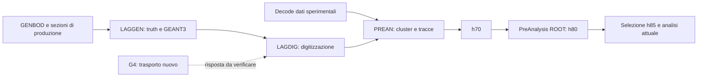

# Mappa dei sorgenti Fortran originali

Inventario e lettura del 27 ottobre 2026 dell'archivio fornito dal responsabile in `docs/reference/fortran/prog/`. Originali preservati al loro posto: nessun binario/script storico eseguito, nessun archivio estratto e nessuna pulizia di oggetti/log/duplicati. La directory è esclusa da Git secondo la configurazione locale del responsabile: i percorsi qui riportati identificano file locali, non promettono disponibilità sul repository remoto.

## Dimensione e livello della mappatura

| Proprietà | Riscontro |
| --- | --- |
| File inventariati, inclusi nascosti | 39.939 |
| Byte logici | 835.020.614, circa 796 MiB; `du` riporta circa 933 MiB allocati |
| Sorgenti `.F/.f` | 2.603 |
| Include/header | 4.378 |
| Oggetti/librerie compilati per estensione | 1.731, tutti `.o` nell'inventario |
| Eseguibili ELF identificati dalla firma | 142 |
| Metadati CVS | 1.197 file |
| Archivi compressi | 4 |
| Contenuti SHA-256 distinti | 17.990; 4.579 gruppi con contenuto duplicato |
| Dichiarazioni PROGRAM/SUBROUTINE/FUNCTION indicizzate | 2.607, da parser lessicale, non da compilazione |

Inventario completo per file, dimensione, tipo e SHA-256 in `results_test/geant4-requirements-20261027/source-inventory.json`; indice simboli in `routine-index.json`; confronto storico in `historical-source-comparison.json`. Sono evidenze della mappa richiesta, non copie dei sorgenti. La classificazione dei file senza estensione/binary generici è preliminare; i 142 ELF non sono tutti certificati come programmi eseguibili per il nostro ambiente. I numeri non sono un call graph risolto o una validazione fisica.

L'archivio contiene molte varianti datate, log, calibrazioni/tagli e build: per esempio 14.795 `.log`, 3.674 `.cut` e 2.053 `.dat`. Contenuto identico non significa file eliminabile: nome, percorso, campagna e ruolo possono differire. La mappa completa copre l'inventario; la lettura funzionale approfondita riguarda soprattutto generazione, digitizzazione, ricostruzione e configurazione.

## Famiglie del progetto

| Directory/famiglia | Ruolo e priorità |
| --- | --- |
| `include/` | Configurazione macchina, dipendenze di build e selezione del periodo. `GRAAL_period.h` seleziona GRAAL_26 nella copia corrente. Prima dipendenza da fissare insieme ai pilot. |
| `laggen/`, `laggen_vale/` | Generazione fisica, materiali/geometria e trasporto GEANT3. Le varianti hanno differenze fisiche: non sceglierne una dalla sola data o dal nome. Priorità massima per G4. |
| `lagdig/` | Risposta/digitizzazione dei depositi simulati. Priorità massima per collegare G4 alla lettura detector. |
| `prean/` | Ricostruzione legacy: cluster, associazione detector, tracce e ntuple h70. Priorità massima per riusare algoritmi sperimentali. |
| `decode/`, `decode_dt/` | Decodifica e calibrazione a monte della ricostruzione dati; verificare i singoli rami quando si segue una variabile, non trattare le copie come intercambiabili. |
| `asymmetry*`, `make_fit/`, `make_fit_hd/` | Famiglie storiche di analisi/fitting: conservare come riferimenti; non riattivano automaticamente moduli dell'analisi corrente o lo stage 09. |
| `etadeu*`, `etaprime*`, `greta/`, `kompton/`, `meson/`, `pimdeu*`, `oldpimdeu/`, `thetadeu*`, `w_norm_*` | Analisi dedicate e varianti di campagna. Possibili fonti di tagli, normalizzazioni e confronti, da leggere con relativo pilot/input prima dell'uso. L'inventario distingue ogni directory; il suo nome non certifica il canale fisico eseguito. |
| `merge_*`, `oldmergepimdeu/` | Programmi/script di lettura, selezione e accorpamento delle analisi storiche; non sono automaticamente semplici concatenazioni di file. |
| `barmon/`, `barmon_deu/`, `counter/`, `check_tbb/`, `spago_w/`, `gann/` | Monitoraggi e utility specializzate. Recuperare il percorso pertinente quando serve un riferimento detector/normalizzazione; non sono prerequisiti universali del trasporto G4. |
| `CVS/`, script alla root, `.o`, ELF, archivi | Provenienza/build/esecuzioni storiche. Non eseguire per dedurne configurazione attiva; leggere sorgenti, Makefile, pilot e dipendenze. |

Le famiglie riassumono tutte le directory di primo livello dell'inventario; i suffissi datati restano separati. La descrizione delle famiglie periferiche è orientativa, mentre i percorsi sotto sono tracciati nei sorgenti.

## Catena scientifica e punto di ingresso di G4

La freccia G4 è il confine progettato, non un adapter già funzionante. Si può riusare o portare la risposta LAGDIG e la ricostruzione PREAN mantenendo equivalenza delle variabili. Il primo obiettivo è evitare una seconda ricostruzione semplificata non confrontata con quella dei dati.

`laggen/src/laggen.F` avvia `UGINIT→GRUN→UGLAST`; `uginit.F` chiama `LAGDATA`, `LAGMAT`, `LAGTMP`, `UGEOM`, `GPHYSI`, `GEN_INIT`. Le macro pilot determinano rami e programmi compilati: `GRAAL_CONDOR_POOL` nel pilot corrente abilita batch attraverso `check_pilot.h`. Le istruzioni di input/output contengono anche percorsi assoluti di vecchie macchine; non sono configurazioni utilizzabili senza ricostruirne il contesto.

`lagdig/src/lagdig.F` inizializza costanti, tagger/geometry lookup, input/output e `EVENTLOOP`; questo richiama `BGOD` e risposte degli altri detector. `prean/src/prean.F:12–24` chiama `READ_OPTION→OPENNTUPLE_IN→CONSTAN→OPENNTUPLE_OUT→READEVENTS`; `analysis.F:96–204` collega cilindri, barrel, BGO, associazione, camere e wall. PREAN scrive l'ntuple ID70 (`include/n-tuple.inc`), che corrisponde al confine h70 letto dalla preanalisi ROOT corrente.

## Geometria, materiali e varianti target

Il confronto con i 58 percorsi `software/prog/...` registrati nel manifest geometrico trova **57 SHA-256 uguali** e una differenza: `laggen/pilot.h`. I file di geometria/materiali comparabili sono uguali, ma un pilot diverso può cambiare il ramo compilato; non dichiarare equivalenza della configurazione senza ricostruirne i define. L'input storico `data/inp_laggen/laggen.dat` è fuori da questo sottoalbero e non è coperto dal confronto.

- `laggen/src/lagdata.F:107–115,299–305`: `TARG/ICIBLE` seleziona materiale e lunghezza; `ICIBLE(2)≤1` dà **11.1 cm**, `=2` dà **6.12 cm**, `≥3` dà **3 cm**. Questo non risolve da solo l'etichetta nominale “12 cm”.
- `lagbers.F:16–38,67–75`: usa `THLENGTH`, costruisce cella/finestre/supporti e li posiziona; cambiare lunghezza comporta rivalutare anche involucro e supporti.
- `lagmat.F:46–54`: H usa densità storica **0.071**, D **0.162 g/cm³**, con masse effettive legacy. I nuovi profili di liquido puro seguono la fonte nominale esplicita, conservando i valori originali nello snapshot storico.
- `vertex.F`: campiona il vertice usando lunghezza e raggio; modificare cella soltanto nel trasporto senza aggiornare distribuzione del vertice sarebbe incoerente.
- `fermi_d.F`, `ev_nuc.F`, `channelex.F`: esistono percorsi nucleari/spettatore per D, da auditare con canali e input. La loro presenza non valida un generatore γD completo per ogni canale moderno.

## Produzione, sezioni d'urto e peso

Dettagli, righe e hash sono nella [mappa delle sezioni d'urto](geant4-cross-section-sources). Risultati che cambiano il piano:

- Totali incorporati in `laggen/src/blockdata.F`/`include/sigto.inc`: `SIGR(64,251)` su griglia W. Alcune serie sono stime/proposte; l'unità e la fonte di ogni serie vanno identificate prima di usarla per rate assoluti.
- Differenziali lette da **`$INP_LAGGEN/channel.mat`**, non inclusa nei file inventariati: `XSECT(64,50,0:18)` e campionamento/interpolazione CM in `gen_evt.F`. Il reader disponibile non equivale alla disponibilità del datafile.
- GENBOD espone `WT`; HBOOK lo registra, l'uscita ASCII aggiunta in `ev_nuc.F` lo omette. Chiamate successive per decadimenti condividono `/GENOUT/`: occorre verificare conservazione/composizione del peso, non assumere che il WT finale sia automaticamente quello dell'intera catena.
- `laggen` e `laggen_vale` differiscono nella reazione effettiva dei canali19/20 (η′ contro η) e nei decadimenti del33. Numero canale, commento o nome di ntuple non sono identità fisica sufficienti.

## PREAN: clustering e PID da riusare

`prean/src/read_option.F:125–136` offre due algoritmi: **frontier** `COUNT_CLUSTER_FR` e **automa cellulare** `COUNT_CLUSTER_CA`. Il primo è presente; il secondo è chiamato ma la definizione non è rintracciata nel corpus, e il Makefile richiede `GLIBCLUSC/libclusC`. Occorre identificare quale algoritmo/configurazione fu usato sui run di interesse.

Frontier (`count_cluster_fr.F:58–125`) lavora su griglia 15×32 con otto vicini e periodicità azimutale; unisce componenti connesse senza separazione automatica di massimi. `anabgo.F` applica soglia cristallo in ADC, soglia cluster, flag e limiti di molteplicità. Le soglie reali derivano da database/configurazione; valori sotto macro inattive non diventano default.

`calc_clust.F` produce energia, EMAX, baricentri e correzione `BGO_ENERGY_CORRECTION`; è descritta come correzione per cluster neutri ma applicata prima dell'associazione. Non è automaticamente una correzione di energia cinetica di protoni/pioni. `sigma_xy_old.F` e `sigma_xy_new.F` producono le variabili SX1/SY1/SX2/SY2 con convenzioni diverse: indici di cristallo/RMS nella versione OLD, coordinate angolari e covarianza nella NEW. Preservare algoritmo e unità, non sostituire con quattro momenti G4 arbitrari.

Per le cariche centrali `anabar.F` calibra energia/tempi delle barre; `find_track_cbb.F:155–158,208–218` costruisce DEDX_TRACK e corregge attenuazione/cammino. In avanti `wall_var.F` tratta guadagni/attenuazione/tempi e `ana_wal.F:472–512` costruisce DE_TRF/TOF_TRF con correzioni geometriche. LAGDIG contiene già risoluzioni, soglie e digitizzazione da confrontare. Queste sono le variabili dei benchmark π/p approvati nei [requisiti](geant4-validation).

## Timing BGO e studio γ/neutrone

Nel PREAN trovato, `TIME_BGO` è un blocco **solo dati**: MHTBGO/IHTBGO/HTBGO per 15 canali e TTOT a 12 bit (`openntuple_out.F:241–250`; origine in `decode/src/detectb.F:173–205`). Non è un tempo calibrato per ciascun cristallo/cluster. Il `BGOD` simulato quantizza/soglia/satura energia senza timing BGO corrispondente. I tempi barrel e TOF forward sono variabili diverse.

Prima di proporre PID γ/n temporale occorre quindi identificare elettronica, mappa canali, tempo zero, calibrazione e associazione ai cluster. Molteplicità, EMAX e larghezze sono invece tracciati fino all'h70; vanno confrontati a soglie, energia visibile e dominio uguali. Un risultato utile sulla separazione non è deducibile dalla sola lettura del sorgente.

## Dipendenze esterne e prossimi recuperi

1. `INP_LAGGEN`: `channel.mat`, card `laggen.dat`; `sigma_pi0.dat` riguarda invece l'asimmetria π0 letta da `gen_init_comp.F`. Profili di fascio HBOOK via `BEAM`, file `gl{h,v}{351,514,300}.hist`.
2. `DATA_BASE`, calibrazioni `CALIB_TAG/STRIP/BGO/BARREL/WALL`, `run.cal`, `run.ped`, `lincorr.dat` e mappa periodo/run. Il corpus sorgente non certifica disponibilità o validità dei database.
3. CERNLIB/GEANT3, librerie locali `libclusC`/`libcernmod`, configurazioni `PROGRAM`, `CERN_ROOT`, `GLIB`; variante automa cellulare e versione GENBOD collegate da fissare. Gli `.o`/ELF non sostituiscono i sorgenti o la provenienza di una build.
4. Controlli dati cariche e configurazione effettiva per i run UV/VIS. Prima portare e confrontare il percorso minimo necessario, poi scalare sul server trima secondo il benchmark concordato.

Queste dipendenze sono state identificate, non dichiarate perdute. L'aggiornamento non ha cambiato tagli di periodo, pesi di produzione correnti, output scientifici o configurazioni della farm.
