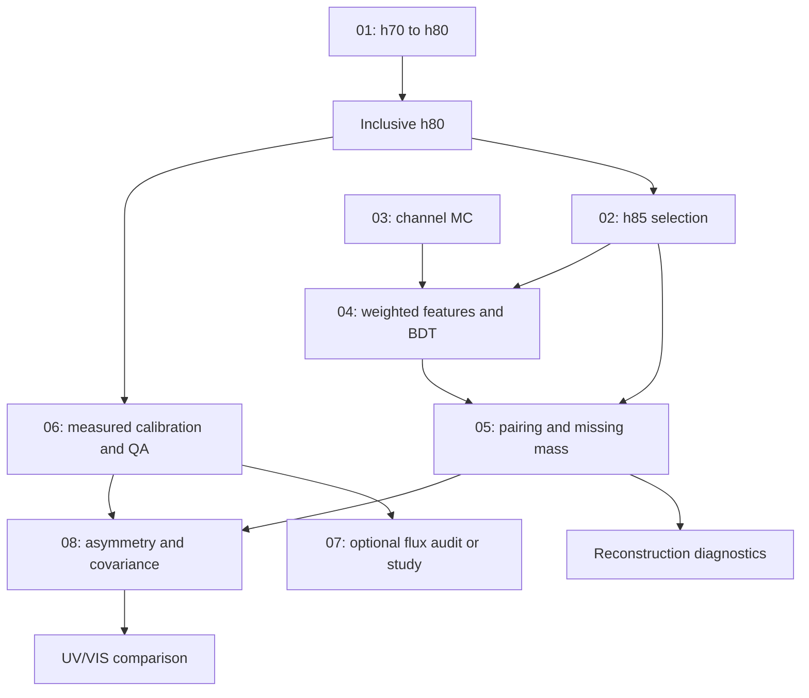

# Workflow and reuse

Il launcher accetta una configurazione per stage con `schema_version: 1`: [esempio completo](https://github.com/AntoninoFulci/GRAAL_Analysis/blob/main/config/pipeline.yaml), [guida a tutte le opzioni](https://github.com/AntoninoFulci/GRAAL_Analysis/blob/main/README.md#pipeline-configurabile-per-stage), [comandi](commands-and-configuration). La CLI legacy senza YAML, come `python scripts/run_pipeline.py --mode production`, mantiene il percorso storico dagli h80. Lo YAML strutturato permette di partire dai raw o da prodotti esterni espliciti.



Le frecce rappresentano dipendenze, non attivazioni automatiche. Ogni stage dichiara `enabled`; ON non accende altri stage. Un consumatore ON richiede un produttore ON oppure un input esterno con produttore OFF. Dichiarare entrambe le fonti è un errore. I prodotti esterni restano di sola lettura e sono validati dai proprietari scientifici prima dell'uso. Un prodotto generato viene validato prima del consumatore; una dipendenza mancante o incompatibile blocca il lancio.

Preanalisi, calibrazione, studio flussi e confronto sono comuni. Selection, MC, BDT, reconstruction, extraction e plots hanno impostazioni `common` e override UV/VIS; un profilo OFF esclude i suoi stage. Il confronto richiede entrambi i profili attivi e le loro estrazioni, con stesso `best_binning`, stesso `phi_bins` se il binning non è adattivo e stessa impostazione candle (attivazione e semiampiezza quando attivo). Binning φ diversi possono essere studiati con comparison OFF, ma non combinati con definizioni incompatibili. La precedenza è default, common, profilo, flag CLI espliciti, infine `--set` su foglie note.

`plots` governa soltanto le diagnostiche dei ricostruiti: masse e quality controls ON per default, Dalitz OFF. Non richiede estrazione o confronto. I grafici propri dell'estrazione rimangono nello stage extraction; comparison compone le estrazioni compatibili e il riferimento pubblicato. Lo studio flussi è opzionale (`enabled: false` per spegnerlo, `mode: audit|study`) e non sostituisce implicitamente il flusso misurato. [Stage 09](09-theory) is retired. Una nuova implementazione richiede una richiesta esplicita.

## Prodotti riusabili e destinazioni

Selection, MC e BDT ammettono `force`: ON + force false permette riuso compatibile; ON + force true rigenera; OFF + force true è errore. OFF non esegue nulla e usa soltanto riferimenti esterni richiesti dai consumatori. I flag legacy `--force-selected`, `--force-mc`, `--force-bdt` restano disponibili. Gli altri stage non ricevono un force generico.

Gli intermedi di produzione vivono in `results/_cache/`. Selection/MC/BDT possono essere riusati entro dieci giorni soltanto con firme e prodotti validi. In `test_data`, questi stage ON rigenerano sotto `artifacts/` della campagna. Un upstream appena rigenerato rende la decisione di cache downstream subordinata alla validazione del nuovo prodotto; il riuso viene rivalutato a quel confine. Il nome visualizzato dello stage non cambia seed o gruppo di cache.

La calibrazione mantiene la cache ROOT+QA legata al contenuto senza TTL; in test_data il riuso è limitato alla radice diagnostica. Vedere [stage 06](06-calibration). Un prodotto esterno di uno stage OFF non è rigenerato a causa dell'età: deve superare i controlli necessari al consumatore. Non si modifica un risultato storico per adeguarlo a un nuovo contratto.

Le campagne contengono `root/`, `plots/`, `metadata/`. Nel percorso strutturato i PDF di ricostruzione stanno in `plots/<profilo>/reconstruction/`, il ROOT diagnostico in `root/<profilo>/reconstruction/istogrammi.root`, i PDF di estrazione in `plots/<profilo>/` e il confronto in `plots/common/`; i default sono `results/production` e `results_test/test_data`. Production richiede una destinazione assente o vuota. Test_data conserva la sostituzione protetta e ripristina l'output precedente in caso di errore. Il lock per modalità impedisce lanci sovrapposti. `execution.cpus`, `execution.seed` ed `extraction.workers` regolano risorse e riproducibilità; il seed training resta distinto.

## Controllo preventivo e provenienza

```bash
python scripts/run_pipeline.py config/pipeline.yaml --check
python scripts/run_pipeline.py config/pipeline.yaml \
  --set campaign.compare_to=results/campagna-precedente \
  --output-dir results/nuova-campagna --check
```

`--check` mostra il piano e valida input, compatibilità e collisioni senza job o scritture della campagna. Il normale lancio richiede conferma dopo il riepilogo. Vengono controllati soltanto runtime e dipendenze degli stage richiesti; gli input dichiarati ma inutilizzati sono segnalati.

`compare_to` legge `metadata/effective_configuration.json` dalla campagna indicata e mostra le differenze. Un riferimento illeggibile o assente è un errore; nessuna ricerca automatica dell'ultima analisi. Senza compare_to, si verificano input/cache usati. Un avviso sui parametri non sostituisce la validazione scientifica e non autorizza sovrascrittura. Metadati h80/selected privi di classificazione affidabile del profilo producono un avviso; una classificazione manuale o incorporata positivamente errata blocca il riuso. Il contratto di estrazioni storiche non certifica `by_period`, `bootstrap_replicas` e `bootstrap_seed`: il riuso segnala questa incertezza oppure si rigenera extraction. Metadata registra configurazione sorgente/effettiva, override, piano, avvisi e identità degli input/prodotti.

La calibrazione ON richiede h80 inclusivi. Con calibrazione OFF occorre la coppia certificata ROOT+QA; l'estrazione richiede comunque la contabilità inclusiva run/stato. Gli h85 selected non sono una sorgente valida di esposizione. `--preanalysis-dir` sceglie un diverso insieme h80; `--require-current-preanalysis` controlla marker tagger e identità raw aggiornati. Il campione diagnostico ridotto è rifiutato in produzione. [Contratti dati](data-and-artifacts) e [stato scientifico](status) distinguono l'esito del software dalla validazione fisica.
