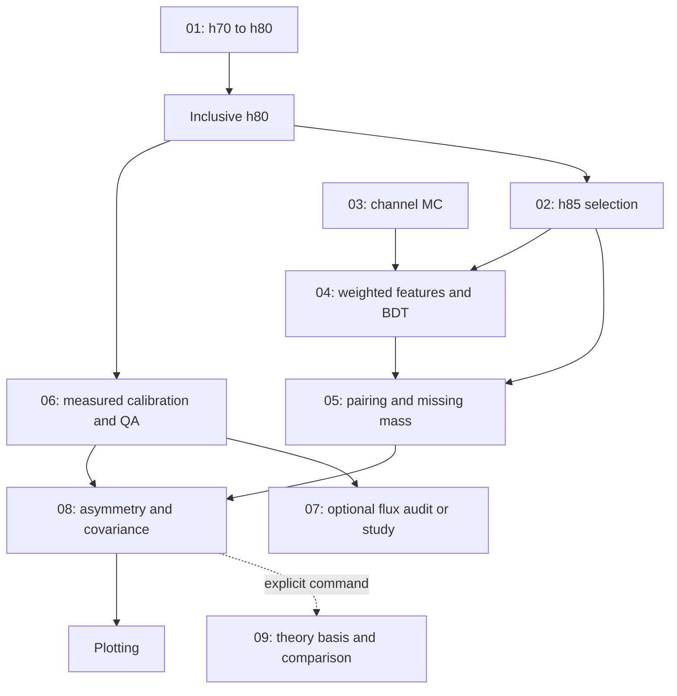

# Workflow and reuse

The full launcher starts from existing h80 pre-analysis, not raw h70. `python scripts/run_pipeline.py --mode production` and `graal-workflow --mode production --repo-root /path/to/checkout` use the same application.

Calibration is common to UV/VIS. Each profile then owns selected inputs, MC, beam spectrum/features, BDT, reconstruction, extraction and plots. Optional stage 07 is requested by `--flux-study audit` or `--flux-study study` and never silently replaces measured flux. [Stage 09](09-theory) is always an explicit command after stage 08 with declared input files; it is not part of launcher execution.

Production intermediates live in `results/_cache/`. Selection, MC and BDT can be reused for ten days only when their signatures and products validate. `--force-selected`, `--force-mc`, and `--force-bdt` request rebuilding these groups. Changing a stage display label does not change its random seed/cache grouping. `--cpus`, `--seed` and `--extraction-workers` bound resources and reproducibility.

Calibration uses its own content-bound ROOT+QA cache without a TTL. See [stage 06](06-calibration). In `test_data`, selection/MC/BDT rebuild under the campaign's `artifacts/`; calibration reuse is confined to the diagnostic artifact root. Outputs default to `results/production` or `results_test/test_data`. Production requires an empty or absent destination; diagnostic replacement is staged and preserves prior valid output on failure. A mode-specific lock prevents overlapping launcher runs.

`--preanalysis-dir` selects a different h80 cohort; `--require-current-preanalysis` checks fresh tagger-discard markers and raw identities. The reduced diagnostic sample is rejected for production. [Data contracts](data-and-artifacts) and [status](status) distinguish execution success from physics validation.
